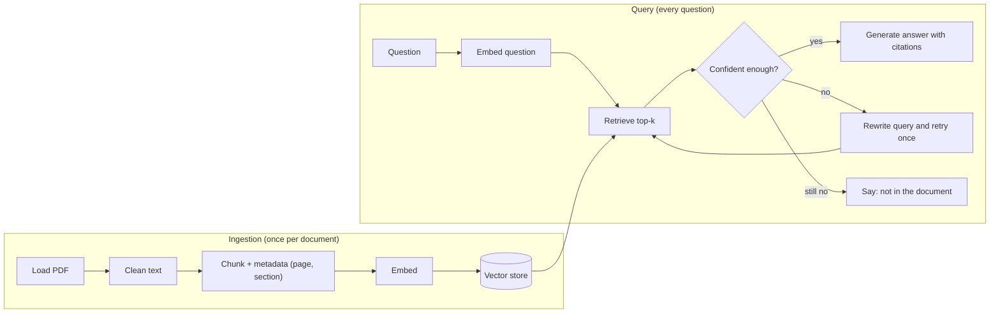
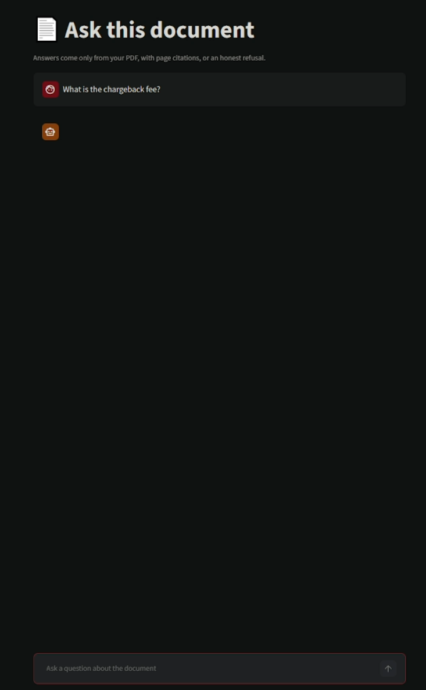

# RAG Document Assistant

Upload a long, messy document and ask questions in plain language. The assistant answers **only from the document**, **shows exactly which page each answer came from**, and **says "I couldn't find that in the document"** when the answer isn't there.


**Demo video (captions only):** [watch on YouTube](https://www.youtube.com/watch?v=cej6HJIf0Eg)

Built as a demonstration of production-grade RAG practices: a swappable vector store abstraction (NumPy / Chroma / pgvector), measured retrieval quality, LLM-as-fallback query rewriting, and a FastAPI + Streamlit frontend — all validated end-to-end for free using local Ollama models, with a one-line switch to production-grade Voyage embeddings + Claude.

## Results

Measured against a 42-question golden set spanning direct facts, table lookups, multi-chunk answers, confusable sections, vague phrasing, and deliberately unanswerable questions — on a real 15-page product requirements document.

| Metric | Result | Target | What it proves |
|---|---|---|---|
| Recall@3 | **0.941** | ≥ 0.85 | The correct page is in the top 3 results 94% of the time |
| Recall@5 | **0.971** | ≥ 0.90 | ...and in the top 5 results 97% of the time |
| MRR | **0.86** | — | The correct page isn't just present — it ranks near the top |
| Top-5 agreement (Chroma vs. brute-force NumPy) | **1.00** | ≥ 0.95 | The ANN vector store returns identical results to an exact, brute-force search |
| Refusal accuracy | **0.976** | — | The model correctly answers or correctly refuses 41 of 42 times |

Full results: [`eval/results/20261114-101108.json`](eval/results/20261114-101108.json)

> **A note on faithfulness scoring:** this build was evaluated using a small local model (`qwen3:4b` via Ollama) as both the answering model and its own faithfulness judge. A model grading its own output is a weak signal, so that number is intentionally left out of the table above. The recall, MRR, agreement, and refusal numbers do not share this weakness — they're measured against the golden set directly, not self-graded.

## How it works



Every answer either cites the exact page it came from, or the system says so when it can't find one — never a confident guess.

## Why three vector stores

| Backend | Use case |
|---|---|
| `numpy` | Brute-force, exact search. No server needed. Serves as the ground-truth baseline that the other two are measured against. |
| `chroma` | Embedded, file-based, one `pip install`. Right for a local prototype or a single-tenant client demo under a few hundred thousand chunks. |
| `pgvector` | Postgres-backed. Right once you already run Postgres and need transactions, joins against business tables, backups, or hybrid keyword + vector search. |

All three implement one abstract interface (`VectorStore`), return cosine similarity in a consistent `[-1, 1]` range regardless of whether the backend natively returns distance, and are swapped with a single CLI flag:

```bash
rag-assistant data/doc.pdf --store numpy
rag-assistant data/doc.pdf --store chroma
rag-assistant data/doc.pdf --store pgvector
```

Full reasoning for this and other architecture decisions: [`docs/architecture.md`](docs/architecture.md).

## Quick start

```bash
python -m venv .venv
source .venv/bin/activate      # Windows: .venv\Scripts\activate.bat
pip install -e ".[chroma,pg,api,ui,dev]"
cp .env.example .env
```

**Free path (no API keys needed):** install [Ollama](https://ollama.com), then:
```bash
ollama pull qwen3:4b
ollama pull nomic-embed-text
```
and set in `.env`:
```bash
ANTHROPIC_BASE_URL=http://localhost:11434
ANTHROPIC_API_KEY=ollama
CLAUDE_MODEL=qwen3:4b
EMBED_PROVIDER=ollama
FORCE_TOOL=false
MIN_SCORE=0.30
RETRY_BELOW=0.50
MAX_TOKENS=4000
```

**Production path:** set `EMBED_PROVIDER=voyage`, `CLAUDE_MODEL=claude-sonnet-5`, and a real `ANTHROPIC_API_KEY` / `VOYAGE_API_KEY`. No code changes required either way — same pipeline, same guards, same tests.

Then:
```bash
rag-assistant data/doc.pdf --store chroma --debug
```

## Try it

Prefer a UI? Start the Streamlit app, upload a PDF in the sidebar, and ask away.



## What's in the box

- **CLI** (`rag-assistant`) — chat with one PDF from the terminal, with `--debug`, `--stream`, `--page` filtering, and backend selection
- **API** (FastAPI) — `/ingest`, `/ask`, `/ask/stream` (SSE), API-key auth, fails closed with no keys configured
- **UI** (Streamlit) — upload a PDF, ask questions, see streamed answers with page citations
- **Eval harness** — recall@k, MRR, ANN-vs-brute-force agreement, refusal accuracy, all computed from one shared embedding pass so results are comparable across backends
- **Retry loop** (LangGraph) — a weak first retrieval triggers one query rewrite before falling back to refusal
- **Tests** — fully offline, fake embeddings and fake LLM clients, zero cost to run in CI
- **Docs** — `docs/architecture.md` (architecture write-up) and `docs/demo.gif` / `docs/demo.png` (demo assets)

## Tech stack

Python · Anthropic Claude (Messages API, tool use, streaming) · Voyage AI / Ollama embeddings · Chroma · pgvector · LangGraph · FastAPI · Streamlit · pytest

## License

MIT