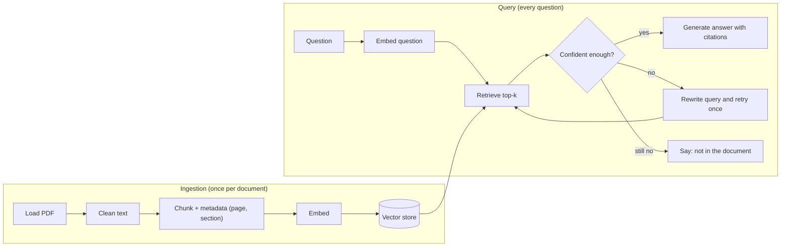

# Architecture

## What this is

A RAG pipeline for one document at a time: load a PDF, chunk it, embed it, retrieve the most relevant chunks for a question, and generate an answer that either cites the exact page it came from or says plainly that the document doesn't cover it. The system never answers from outside knowledge — a tool-call contract with the LLM, backed by code-level guards, enforces this rather than relying on a prompt alone.

## Pipeline

Chunks never cross a page boundary. This is a deliberate constraint, not an oversight: it means every chunk has exactly one page number, which is what makes a citation verifiable — a reader can turn to that page and check the claim.

## Why abstract the vector store at all

Three backends sit behind one interface (`VectorStore`): `numpy`, `chroma`, `pgvector`. The honest cost of this abstraction is real — three implementations of `search()` instead of one, three sets of contract tests, more surface area to keep in sync. The benefit is that it proves the system's actual logic (chunking, retrieval, the citation guards) is independent of any one database, which matters both as a demonstration of engineering judgment and as a practical freelance/client concern: different clients have different constraints, and "swap one flag" is a real answer to "can this run on our infrastructure."

**When to pick which:**

- **NumPy** — exact, brute-force search. No server, no approximation. This is the ground-truth baseline every other backend is measured against, and it's why `agreement_vs_numpy` is a meaningful metric at all: ANN search is *approximate* by design, so without a brute-force baseline there's no way to know whether a low score is bad retrieval or just bad luck in the approximation.
- **Chroma** — a single `pip install`, embedded, persists to a local file. Right for a local prototype, a single-tenant client demo, or any deployment under a few hundred thousand chunks where running a separate database server isn't worth the operational cost.
- **pgvector** — right the moment a project already runs Postgres and needs transactions, joins against existing business tables, row-level security, real backups, or hybrid keyword + vector search in one query. The honest trade-off: pgvector is operationally heavier (a real database to run and tune) and its ANN parameters (`ef_search`, `ef_construction`) need hands-on tuning, where Chroma hides that complexity at the cost of being one more system with its own lifecycle.

## The score contract

Chroma and pgvector both return **distance** natively (0 = identical), not similarity. Every backend converts to **cosine similarity in `[-1, 1]`, higher is better**, at the boundary — inside `ChromaStore.search()` and `PgVectorStore.search()` respectively, never left for calling code to handle. This is what lets `MIN_SCORE`, `RETRY_BELOW`, and the three answer-time guards in `generation.py` stay completely backend-independent: they only ever see similarity, regardless of which store is in use underneath.

## Document identity and citations in a shared store

`doc_id` is `sha256(pdf bytes + embed model + chunk settings)`, truncated to 16 hex characters. This single value does two jobs at once: it's the cache key ("have I already indexed this exact file with these exact settings?"), and it's the metadata filter that keeps documents separated in a shared Chroma collection or Postgres table.

Chunk ids restart at 0 for every document, so in a shared table `chunk_id` alone is not globally unique — `(doc_id, chunk_id)` together is. Citations returned to the user stay as plain per-document integers (`chunk 4`, `page 10`) rather than exposing the compound key, because that's the simplest contract for the LLM's tool call and for `generation.py`, which never needs to know a shared table exists underneath it.

## Retry loop

A LangGraph state machine wraps retrieval with one optional rewrite: if the top retrieval score is merely weak (below `RETRY_BELOW`) rather than hopeless (below `MIN_SCORE`), the question is rewritten once into more formal/expanded search language and retried. Hits from every attempt are merged by taking the best score per chunk, never replaced — so a bad rewrite can only add candidates, never remove a good one the first attempt already found. If retrieval comes back completely empty (an empty store, or a metadata filter that matched nothing), the loop skips the rewrite entirely and goes straight to refusal, since no rewrite can produce chunks that don't exist.

## Three guards before any answer reaches the user

1. **Score guard** (free, no LLM call): if the best retrieved score is below `MIN_SCORE`, refuse immediately — there's no point paying for a generation call when retrieval already failed.
2. **Model self-report**: the LLM's own tool call includes `answerable: bool`. If the model itself says the chunks don't contain the answer, that's respected over being overridden.
3. **Citation validation**: any citation referencing a chunk that wasn't actually sent to the model is dropped. If zero valid citations remain, the answer is rejected regardless of what text the model produced — an answer with no real citation is treated as equivalent to a refusal.

Streamed tokens are explicitly provisional under this design: the full tool call has to complete before guards 2 and 3 can run, so a frontend may show text as it streams and then have to visibly correct it if the final guards reject that answer. This is a real trade-off of streaming with this generate-then-validate approach, and it's handled explicitly in the CLI and Streamlit UI rather than silently glossed over.

## What's measured, and what it proves

| Metric | What it actually tests |
|---|---|
| recall@3, recall@5 | Does the correct page appear in the top-k retrieved chunks at all |
| MRR | Does the correct page rank near the top, not just somewhere in top-k |
| agreement_vs_numpy | Does the ANN backend (Chroma) return the same chunks as exact brute-force search |
| p95 latency | Real search speed per backend, not a theoretical estimate |
| refusal_accuracy | Does the system correctly distinguish "I can answer this" from "I can't," measured against a labeled golden set |

Relevance is judged by **page number**, not chunk id, deliberately: chunk ids shift whenever `CHUNK_SIZE` or `CHUNK_OVERLAP` change, but page numbers don't — so one golden set keeps working across every retrieval-tuning experiment without being rewritten.

**On the faithfulness metric specifically:** this build's `--generate` evaluation used `qwen3:4b` (via Ollama) as both the answering model and its own faithfulness judge. A model judging its own output is a known weak signal — it tends to be lenient on itself — so a result of 1.0 faithfulness should be read as "the judge didn't catch anything," not "every answer was perfectly grounded." A stronger, independent judge model is the natural next step before treating that particular number as reliable.

## Known limitations and the upgrade path

- Validated end-to-end on local, free models (`qwen3:4b` + `nomic-embed-text` via Ollama) specifically so the whole pipeline — ingestion, all three vector stores, retry logic, the API, the UI — could be tested for zero cost before any real spending.
- The provider abstraction means moving to production-grade models is a `.env` change, not a code change: `EMBED_PROVIDER=voyage`, `CLAUDE_MODEL=claude-sonnet-5`, with real API keys. Nothing else in the pipeline needs to know which provider it's talking to.
- Small local models via Ollama do not stream tool-call arguments incrementally the way the real Anthropic API does — Ollama's compatibility layer sends the full tool call as a single chunk after its internal reasoning finishes, so `--stream` won't visibly trickle text on this model, even though the underlying streaming code is written correctly for providers that do send real deltas.
- `pgvector` is implemented and tested against a real Dockerized Postgres instance (tests pass, manual Q&A verified, full stack reachable via `docker compose up --build`), but connection pooling is a parked improvement — a single connection is adequate for a CLI or small API, not for production concurrency.

## Interview questions this project is meant to answer

- *Why abstract the vector store at all, and what's the actual cost of the abstraction?* — see "Why abstract the vector store at all," above.
- *Chroma vs. pgvector — when do you pick which?* — see the backend table, above.
- *Your stores return distance; your guards expect similarity. Where do you convert, and why there?* — at each backend's own `search()` boundary, so every layer above it only ever deals in one consistent unit.
- *HNSW is approximate — how do you know you didn't silently lose recall?* — the NumPy backend is kept specifically as an exact, brute-force ground truth, and `agreement_vs_numpy` measures the gap directly rather than assuming it's zero.
- *Chunk ids restart per document — how does that not break citations in a shared table?* — `(doc_id, chunk_id)` is the real primary key; citations shown to the user are deliberately simpler, per-document integers.